<div align="center">


<a href="https://kajpa.pl">
  <picture>
    <source media="(prefers-color-scheme: dark)" srcset="https://readme-typing-svg.demolab.com?center=true&vCenter=true&font=JetBrains+Mono&weight=600&size=20&duration=2800&pause=1200&color=22D3EE&width=720&height=44&lines=I+build+devices+that+talk+to+the+cloud;PCB+%E2%86%92+firmware+%E2%86%92+backend+%E2%86%92+dashboard;Founder+%26+CTO+%40+Kajpa+%C2%B7+Co-founder+%40+PNLABS;60%2B+commercial+projects+shipped" />
    
  </picture>
</a>

<p>
  <a href="https://kajpa.pl"></a>
  <a href="mailto:kacper@kajpa.pl"></a>
  <a href="https://kalkmate.pl"></a>
  
</p>

</div>

## 👋 About me

I build complete systems: the PCB, the firmware, the backend and the dashboard someone actually clicks. I run my own company, **KAJPA Kacper Popko**. Under it I lead **[Kajpa](https://kajpa.pl)**, a boutique tech studio from Białystok that has shipped 60+ commercial projects in IoT, AI automation and custom SaaS ([case studies](https://kajpa.pl/pl/realizacje)), and I make and sell my own device, **[KalkMate](https://kalkmate.pl)**. I also co-founded **PNLABS**, a hardware startup.

```python
class Kacper:
    based_in = "Białystok, Poland 🇵🇱"
    company = "KAJPA Kacper Popko"  # Kajpa studio + KalkMate
    roles = {
        "Kajpa": "Founder & CTO",  # IoT, AI automation, custom SaaS
        "PNLABS": "Co-founder",  # hardware startup behind PetBand
    }
    shipped = "60+ commercial projects"
    stack = [
        "ESP32 + C++",
        "Python + FastAPI",
        "Next.js + TypeScript",
        "KiCad / Fusion Electronics",
        "LLM pipelines",
    ]
    now = ["KalkMate camera upgrade", "PetBand firmware", "lcsc2fusion"]
    off_the_clock = [
        "ECU tuning (own EDC15 remap, 90 → 120 hp on the dyno)",
        "Yamaha MT-07",
        "3D printing",
    ]

    def __repr__(self) -> str:
        return "PCB → firmware → backend → dashboard. No handoffs."
```

## 🚀 Featured work

<table>
<tr>
<td width="50%" valign="top">

### 🧮 [KalkMate](https://kalkmate.pl)

An AI study calculator for students preparing for the Polish matura. Snap a math, physics, chemistry or biology problem with the built-in camera and get a fully explained solution on the OLED, no phone involved.

`ESP32-S3` `C++` `Next.js` `Gemini` `Stripe` `signed OTA`

<sub>🟢 In production · <a href="https://github.com/KAJPER/KalkMate">source</a></sub>

</td>
<td width="50%" valign="top">

### 🐝 [BeePilot](https://kajpa.pl/pl/realizacje/beepilot)

Modular IoT beehive monitoring. ESP32-C6 sensor nodes track hive weight, climate, sound and motion, then report over an ESP-NOW mesh to a LoRa or LTE hub with a SaaS dashboard on top.

`ESP32-C6` `ESP-NOW` `LoRa` `LTE` `SaaS`

<sub>🔋 26 days on battery in winter · <a href="https://kajpa.pl/pl/realizacje/beepilot">case study</a></sub>

</td>
</tr>
<tr>
<td width="50%" valign="top">

### 🐾 PetBand

A health wearable for pets that tracks heart rate, SpO₂, temperature and activity, with an owner app and a web panel for vet clinics. I build the firmware: sensor integration and BLE.

`ESP32-S3` `BLE` `PPG` `NFC` `C++`

<sub>🏢 PNLABS sp. z o.o. · 🏆 El-Robo-Mech laureate</sub>

</td>
<td width="50%" valign="top">

### ♻️ BinPilot

An AI waste-sorting bin. A vision model we trained ourselves runs on a Raspberry Pi 5, sorts trash into four streams, and a stepper-driven mechanism drops each item into the right bin.

`Raspberry Pi 5` `Python` `ONNX Runtime` `OpenCV` `NEMA 17`

<sub>🏆 El-Robo-Mech laureate · team build</sub>

</td>
</tr>
<tr>
<td width="50%" valign="top">

### 🔌 [lcsc2fusion](https://github.com/KAJPER/lcsc2fusion)

Search an LCSC part, press one button and get its symbol, footprint and 3D model in your Fusion Electronics library. Comes with a CLI and an MCP server, so Claude can add parts for you.

`Python` `Fusion API` `MCP` `3900+ tests` `MIT`

<sub>🧩 Open source · <a href="https://github.com/KAJPER/lcsc2fusion">repo</a></sub>

</td>
<td width="50%" valign="top">

### ✍️ [Piszo](https://piszo.pl)

SaaS that automates SEO blogging with AI. A FastAPI backend plus a custom WordPress plugin, so new posts land straight on the client's site.

`Python` `FastAPI` `LLM` `WordPress`

<sub>🟢 Live · <a href="https://piszo.pl">piszo.pl</a></sub>

</td>
</tr>
</table>

<details>
<summary><b>More builds</b></summary>
<br />

- 📏 **[Ultrasonic rangefinder](https://github.com/KAJPER/WETI)**: hybrid pulse-phase ranging (time of flight plus Goertzel phase detection) on an ATtiny1616, aiming for sub-millimeter accuracy at 10 to 50 cm. Finalist of Wygraj Indeks WETI 2026.
- 🌐 **Veois** <sub>(in development)</sub>: an AI website builder. Client briefs go in, Claude generates the site, the client polishes it in a visual editor. FastAPI, Next.js, Celery, multi-tenant with custom domains.
- 🔐 **PrivChat** <sub>(design stage)</sub>: architecture for an open-source E2EE messenger with hybrid post-quantum key exchange, zero-knowledge relays and Loopix-style cover traffic.
- 🚗 **OBD-II wireless gauge** <sub>(in progress)</sub>: a dongle in the OBD port streams live engine data to an ESP32 with a round touch display.
- 🖨️ **Print autopilot** <sub>(in progress)</sub>: a Python pipeline on Moonraker that slices, uploads, starts and clears prints on my Kobra S1.

</details>

## 🧰 Toolbox

<p align="center">
  <a href="https://skillicons.dev"></a>
  <br />
  <a href="https://skillicons.dev"></a>
</p>

<p align="center">
  
  
  
  
  
  
  <br />
  
  
  
  
  
  
</p>

## 🏆 Recognition

- 🥇 **Wschodzący Innowatorzy**: 1st place
- 🤖 **El-Robo-Mech** (Białystok University of Technology): laureate twice, with PetBand and BinPilot
- 🎓 **Wygraj Indeks WETI 2026** (Gdańsk University of Technology): finalist with the ultrasonic rangefinder
- 🏛️ **Scholarship of the Mayor of Białystok** for innovative technical thinking, awarded several times

## 📊 GitHub activity

<p align="center">
  
  
</p>

<p align="center">
  
</p>

<p align="center">
  <picture>
    <source media="(prefers-color-scheme: dark)" srcset="https://raw.githubusercontent.com/KAJPER/KAJPER/HEAD/profile/snake-dark.svg" />
    
  </picture>
</p>

<br />

<p align="center">
  <b>Got a process worth automating or a device worth building?</b><br />
  Write to <a href="mailto:kacper@kajpa.pl">kacper@kajpa.pl</a> or drop by <a href="https://kajpa.pl">kajpa.pl</a>.
</p>


